# UX audit for 08de82d

Configs: big-text, ipad, pro-light, small-phone. Journeys recorded: 52.

## Failed checks (severity 4 blocks the task, 1 is cosmetic)

None.

## Benchmarks (targets in docs/audit/benchmarks.json)

0 over target.

| Config | What | Result | Target | |
|---|---|---|---|---|
| big-text | job: Join the next meeting | 1 taps | 1 | ok |
| big-text | job: Undo a pop | 1 taps | 1 | ok |
| big-text | job: Skip a meeting | 1 taps | 1 | ok |
| big-text | job: Pop the late bubble | 1 taps | 1 | ok |
| big-text | job: Ring 2 minutes before | 2 taps | 3 | ok |
| big-text | job: Find and turn off one calendar | 3 taps | 3 | ok |
| big-text | job: Turn off a whole account | 1 taps | 1 | ok |
| ipad | job: Join the next meeting | 1 taps | 1 | ok |
| ipad | job: Undo a pop | 1 taps | 1 | ok |
| ipad | job: Skip a meeting | 1 taps | 1 | ok |
| ipad | job: Pop the late bubble | 1 taps | 1 | ok |
| ipad | job: Ring 2 minutes before | 2 taps | 3 | ok |
| ipad | job: Find and turn off one calendar | 3 taps | 3 | ok |
| ipad | job: Turn off a whole account | 1 taps | 1 | ok |
| pro-light | job: Join the next meeting | 1 taps | 1 | ok |
| pro-light | job: Undo a pop | 1 taps | 1 | ok |
| pro-light | job: Skip a meeting | 1 taps | 1 | ok |
| pro-light | job: Pop the late bubble | 1 taps | 1 | ok |
| pro-light | job: Ring 2 minutes before | 2 taps | 3 | ok |
| pro-light | job: Find and turn off one calendar | 3 taps | 3 | ok |
| pro-light | job: Turn off a whole account | 1 taps | 1 | ok |
| small-phone | job: Join the next meeting | 1 taps | 1 | ok |
| small-phone | job: Undo a pop | 1 taps | 1 | ok |
| small-phone | job: Skip a meeting | 1 taps | 1 | ok |
| small-phone | job: Pop the late bubble | 1 taps | 1 | ok |
| small-phone | job: Ring 2 minutes before | 2 taps | 3 | ok |
| small-phone | job: Find and turn off one calendar | 3 taps | 3 | ok |
| small-phone | job: Turn off a whole account | 1 taps | 1 | ok |

## Pictures changed since the baseline

No baseline yet. This run's pictures become the baseline.

## Accessibility audit (Apple's), by issue

By type: contrast 60, dynamicType 35, textClipped 34, elementDetection 9, auditError 4, hitRegion 3, description 3

- auditError on alarms-why: Error Domain=com.apple.xcode.xctest.accessibilityAudit Code=-56 "Audit failed to complete in time" UserInfo={NSLocalizedDescription=Audit failed to complete in time} [no label] (big-text)
- auditError on calendars-why: Error Domain=com.apple.xcode.xctest.accessibilityAudit Code=-56 "Audit failed to complete in time" UserInfo={NSLocalizedDescription=Audit failed to complete in time} [no label] (big-text)
- auditError on hello: Error Domain=com.apple.xcode.xctest.accessibilityAudit Code=-56 "Audit failed to complete in time" UserInfo={NSLocalizedDescription=Audit failed to complete in time} [no label] (big-text)
- auditError on settings: Error Domain=com.apple.xcode.xctest.accessibilityAudit Code=-56 "Audit failed to complete in time" UserInfo={NSLocalizedDescription=Audit failed to complete in time} [no label] (ipad)
- contrast on settings-bottom: Contrast failed [no label] (ipad)
- contrast on settings-bottom: Contrast failed [$2.99] (ipad)
- contrast on settings-bottom: Contrast failed [$4.99] (ipad)
- contrast on grenade-home: Contrast failed [4:56 PM to 5:26 PM] (big-text)
- contrast on grenade-home: Contrast failed [4:59 PM to 5:29 PM] (small-phone)
- contrast on missed: Contrast failed [5:05 PM to 5:35 PM · Zoom] (big-text)
- contrast on missed: Contrast failed [5:07 PM to 5:37 PM · Zoom] (small-phone)
- contrast on alarms-why: Contrast failed [A banner at the top. Tap it for the bubble.] (ipad)
- contrast on settings-bottom: Contrast failed [Accepted meetings only] (ipad, pro-light, small-phone)
- contrast on settings-bottom: Contrast failed [Apple Reminders] (ipad, pro-light, small-phone)
- contrast on calendars: Contrast failed [Birthdays] (ipad)
- contrast on theme-gallery: Contrast failed [Coral] (big-text)
- contrast on pro-sheet: Contrast failed [Desk mode: keep the screen on while Pop In is open] (ipad)
- contrast on settings-bottom: Contrast failed [Done] (big-text, ipad, pro-light)
- contrast on theme-gallery: Contrast failed [Donut ✦] (ipad, pro-light, small-phone)
- contrast on pro-sheet: Contrast failed [Every theme, plus each new one through the year] (ipad, pro-light)
- contrast on theme-gallery: Contrast failed [Eyeball ✦] (pro-light, small-phone)
- contrast on calendars: Contrast failed [Family] (ipad)
- contrast on pro-sheet: Contrast failed [Fortune: black glass, a violet glow and a meeting fortune] (ipad, pro-light)
- contrast on settings-bottom: Contrast failed [Like Pop In? A tip helps keep it going. Tips don't unlock anything.] (ipad)
- contrast on settings-bottom: Contrast failed [Like a desk clock while Pop In is open] (ipad)
- contrast on alarms-why: Contrast failed [Meetings with a video link ring like an alarm, even in Silent and Focus. Other events get a quiet notification. iPhone decides how the alarm looks:] (pro-light, small-phone)
- contrast on pro-sheet: Contrast failed [Moon and Grenade themes, each with its own pop] (ipad, small-phone)
- contrast on pro-sheet: Contrast failed [More alarm sounds: Popcorn, Chimes, Oracle and Sonar] (ipad, small-phone)
- contrast on moon-home: Contrast failed [Next transmission · Zoom] (ipad, pro-light)
- contrast on covered: Contrast failed [Next up: Design review, 4:46 PM. Pop In will ring 2 min before.] (pro-light)
- contrast on covered: Contrast failed [Next up: Design review, 4:50 PM. Pop In will ring 2 min before.] (small-phone)
- contrast on home-far: Contrast failed [Next · Meet] (pro-light)
- contrast on fortune-home: Contrast failed [Next · Zoom] (pro-light)
- contrast on unicorn-home: Contrast failed [Next · Zoom] (small-phone)
- contrast on fortune-home: Contrast failed [Not going] (small-phone)
- contrast on grenade-home: Contrast failed [Not going] (pro-light, small-phone)
- contrast on missed: Contrast failed [Not going] (ipad, pro-light, small-phone)
- contrast on moon-home: Contrast failed [Not going] (small-phone)
- contrast on ringing: Contrast failed [Not going] (ipad, pro-light, small-phone)
- contrast on pro-sheet: Contrast failed [Per-calendar alerts: Alarm, Smart or Gentle] (ipad)
- contrast on alarms-why: Contrast failed [Phone locked] (pro-light)
- contrast on theme-gallery: Contrast failed [Planet ✦] (ipad)
- contrast on settings-bottom: Contrast failed [Ring for reminders with a time, like ones you ask Siri for] (ipad, pro-light, small-phone)
- contrast on fortune-home: Contrast failed [Rings 2 min before] (pro-light)
- contrast on unicorn-home: Contrast failed [Rings 2 min before] (big-text)
- contrast on settings-bottom: Contrast failed [Skip meetings you haven't accepted yet] (ipad)
- contrast on calendars: Contrast failed [Smart] (ipad)
- contrast on theme-gallery: Contrast failed [Soap bubble ✦] (ipad, small-phone)
- contrast on settings-bottom: Contrast failed [Support Pop In] (ipad)
- contrast on fortune-home: Contrast failed [The first two minutes are about the weather.] (pro-light, small-phone)
- contrast on grenade-home: Contrast failed [Then 5:49 PM, Team standup] (pro-light)
- contrast on empty: Contrast failed [Try a pop] (pro-light)
- contrast on pro-sheet: Contrast failed [Unicorn mode: a rainbow bubble that bursts into confetti] (big-text, pro-light)
- contrast on theme-gallery: Contrast failed [Water balloon ✦] (ipad)
- contrast on settings-bottom: Contrast failed [Work hours] (big-text)
- contrast on empty: Contrast failed [Your next two days are clear on the calendars Pop In watches.] (big-text, small-phone)
- contrast on playground: Contrast failed [🐠] (pro-light)
- contrast on theme-gallery: Contrast failed [🐠] (pro-light)
- contrast on theme-gallery: Contrast nearly passed [Bubblegum] (ipad, small-phone)
- contrast on theme-gallery: Contrast nearly passed [Mood ring ✦] (small-phone)
- contrast on theme-gallery: Contrast nearly passed [Moon ✦] (ipad, pro-light, small-phone)
- contrast on alarms-why: Contrast nearly passed [Open] (ipad, pro-light, small-phone)
- contrast on add-reminder: Contrast nearly passed [Reminders stay on this iPhone and ring like a meeting. Swipe one to delete it.] (ipad, pro-light, small-phone)
- contrast on theme-gallery: Contrast nearly passed [Unicorn ✦] (ipad, pro-light, small-phone)
- description on pro-sheet: Label not human-readable [bell.and.waves.left.and.right] (ipad, pro-light, small-phone)
- description on pro-sheet: Label not human-readable [ipad.landscape] (ipad, pro-light, small-phone)
- description on pro-sheet: Label not human-readable [square.grid.3x3] (ipad, pro-light, small-phone)
- dynamicType on theme-gallery: Dynamic Type font sizes are partially unsupported [A different theme each day, picked from the ones you have.] (big-text, ipad, pro-light, small-phone)
- dynamicType on add-reminder: Dynamic Type font sizes are partially unsupported [Add] (ipad, pro-light, small-phone)
- dynamicType on theme-gallery: Dynamic Type font sizes are partially unsupported [Bubblegum] (ipad, pro-light, small-phone)
- dynamicType on add-reminder: Dynamic Type font sizes are partially unsupported [Cancel] (ipad, pro-light, small-phone)
- dynamicType on theme-gallery: Dynamic Type font sizes are partially unsupported [Changes once a day when you open Pop In] (big-text, ipad, pro-light, small-phone)
- dynamicType on theme-gallery: Dynamic Type font sizes are partially unsupported [Classic] (big-text, ipad, pro-light, small-phone)
- dynamicType on theme-gallery: Dynamic Type font sizes are partially unsupported [Coral] (ipad, pro-light, small-phone)
- dynamicType on theme-gallery: Dynamic Type font sizes are partially unsupported [Disco ✦] (ipad, pro-light, small-phone)
- dynamicType on settings: Dynamic Type font sizes are partially unsupported [Done] (big-text, pro-light, small-phone)
- dynamicType on settings-bottom: Dynamic Type font sizes are partially unsupported [Done] (big-text, ipad, pro-light, small-phone)
- dynamicType on theme-gallery: Dynamic Type font sizes are partially unsupported [Donut ✦] (pro-light, small-phone)
- dynamicType on theme-gallery: Dynamic Type font sizes are partially unsupported [Fortune ✦] (ipad, pro-light, small-phone)
- dynamicType on theme-gallery: Dynamic Type font sizes are partially unsupported [Grenade ✦] (ipad, pro-light, small-phone)
- dynamicType on theme-gallery: Dynamic Type font sizes are partially unsupported [Moon ✦] (ipad, pro-light, small-phone)
- dynamicType on theme-gallery: Dynamic Type font sizes are partially unsupported [Planet ✦] (pro-light, small-phone)
- dynamicType on alarms-why: Dynamic Type font sizes are partially unsupported [Pop In] (ipad, pro-light, small-phone)
- dynamicType on theme-gallery: Dynamic Type font sizes are partially unsupported [Pro favorites] (ipad, pro-light, small-phone)
- dynamicType on add-reminder: Dynamic Type font sizes are partially unsupported [Reminders stay on this iPhone and ring like a meeting. Swipe one to delete it.] (ipad, pro-light, small-phone)
- dynamicType on theme-gallery: Dynamic Type font sizes are partially unsupported [Soap bubble ✦] (ipad, pro-light, small-phone)
- dynamicType on theme-gallery: Dynamic Type font sizes are partially unsupported [Surprise me ✦] (big-text, ipad, pro-light, small-phone)
- dynamicType on theme-gallery: Dynamic Type font sizes are partially unsupported [Unicorn ✦] (ipad, pro-light, small-phone)
- dynamicType on theme-gallery: Dynamic Type font sizes are partially unsupported [Water balloon ✦] (pro-light, small-phone)
- dynamicType on fortune-home: Dynamic Type font sizes are unsupported [The first two minutes are about the weather.] (ipad, pro-light, small-phone)
- dynamicType on alarms-why: Dynamic Type font sizes are unsupported [pop in] (ipad, pro-light, small-phone)
- dynamicType on calendars-why: Dynamic Type font sizes are unsupported [pop in] (ipad, pro-light, small-phone)
- dynamicType on covered: Dynamic Type font sizes are unsupported [pop in] (big-text, ipad, pro-light, small-phone)
- dynamicType on empty: Dynamic Type font sizes are unsupported [pop in] (big-text, ipad, pro-light, small-phone)
- dynamicType on fortune-home: Dynamic Type font sizes are unsupported [pop in] (ipad, pro-light, small-phone)
- dynamicType on grenade-home: Dynamic Type font sizes are unsupported [pop in] (ipad, pro-light, small-phone)
- dynamicType on hello: Dynamic Type font sizes are unsupported [pop in] (ipad, pro-light, small-phone)
- dynamicType on home: Dynamic Type font sizes are unsupported [pop in] (ipad, pro-light, small-phone)
- dynamicType on home-far: Dynamic Type font sizes are unsupported [pop in] (ipad, pro-light, small-phone)
- dynamicType on moon-home: Dynamic Type font sizes are unsupported [pop in] (ipad, pro-light, small-phone)
- dynamicType on unicorn-home: Dynamic Type font sizes are unsupported [pop in] (ipad, pro-light, small-phone)
- dynamicType on playground: Dynamic Type font sizes are unsupported [🐠] (ipad, pro-light)
- elementDetection on calendars: Potentially inaccessible element [no label] (ipad)
- elementDetection on settings-bottom: Potentially inaccessible element [no label] (ipad)
- elementDetection on add-reminder: Potentially inaccessible text [no label] (ipad)
- elementDetection on calendars: Potentially inaccessible text [no label] (ipad)
- elementDetection on pro-sheet: Potentially inaccessible text [no label] (ipad)
- elementDetection on ring-before: Potentially inaccessible text [no label] (ipad)
- elementDetection on settings-bottom: Potentially inaccessible text [no label] (ipad)
- elementDetection on sound: Potentially inaccessible text [no label] (ipad)
- elementDetection on theme-gallery: Potentially inaccessible text [no label] (ipad)
- hitRegion on missed: Hit area is too small [Missed: 4:38 PM Weekly sync · Join] (pro-light)
- hitRegion on missed: Hit area is too small [Missed: 4:40 PM Weekly sync · Join] (small-phone)
- hitRegion on missed: Hit area is too small [Missed: 4:41 PM Weekly sync · Join] (ipad)
- textClipped on add-reminder: Text clipped [no label] (ipad, pro-light, small-phone)
- textClipped on calendars: Text clipped [no label] (big-text, pro-light, small-phone)
- textClipped on theme-gallery: Text clipped [A different theme each day, picked from the ones you have.] (ipad, small-phone)
- textClipped on calendars: Text clipped [Anniversaries] (pro-light, small-phone)
- textClipped on add-reminder: Text clipped [Cancel] (pro-light, small-phone)
- textClipped on theme-gallery: Text clipped [Changes once a day when you open Pop In] (ipad, small-phone)
- textClipped on theme-gallery: Text clipped [Classic] (ipad, small-phone)
- textClipped on home-far: Text clipped [Design review] (ipad)
- textClipped on fortune-home: Text clipped [Lunch with Sam] (ipad)
- textClipped on grenade-home: Text clipped [Lunch with Sam] (ipad)
- textClipped on home: Text clipped [Lunch with Sam] (ipad)
- textClipped on home-far: Text clipped [Lunch with Sam] (ipad)
- textClipped on moon-home: Text clipped [Lunch with Sam] (ipad)
- textClipped on unicorn-home: Text clipped [Lunch with Sam] (ipad)
- textClipped on missed: Text clipped [Missed: 4:38 PM Weekly sync · Join] (big-text, pro-light)
- textClipped on missed: Text clipped [Missed: 4:40 PM Weekly sync · Join] (small-phone)
- textClipped on missed: Text clipped [Missed: 4:41 PM Weekly sync · Join] (ipad)
- textClipped on moon-home: Text clipped [Next transmission · Zoom] (big-text, ipad, pro-light, small-phone)
- textClipped on theme-gallery: Text clipped [Pro favorites] (ipad, small-phone)
- textClipped on add-reminder: Text clipped [Reminders stay on this iPhone and ring like a meeting. Swipe one to delete it.] (pro-light, small-phone)
- textClipped on theme-gallery: Text clipped [Soap bubble ✦] (pro-light, small-phone)
- textClipped on fortune-home: Text clipped [Sprint planning] (ipad)
- textClipped on grenade-home: Text clipped [Sprint planning] (ipad)
- textClipped on home: Text clipped [Sprint planning] (ipad)
- textClipped on moon-home: Text clipped [Sprint planning] (ipad)
- textClipped on unicorn-home: Text clipped [Sprint planning] (ipad)
- textClipped on fortune-home: Text clipped [Team standup] (ipad)
- textClipped on grenade-home: Text clipped [Team standup] (ipad)
- textClipped on home: Text clipped [Team standup] (ipad)
- textClipped on home-far: Text clipped [Team standup] (ipad)
- textClipped on moon-home: Text clipped [Team standup] (ipad)
- textClipped on unicorn-home: Text clipped [Team standup] (ipad)
- textClipped on theme-gallery: Text clipped [Water balloon ✦] (pro-light, small-phone)
- textClipped on playground: Text clipped [🐠] (ipad, pro-light)

## Timings

## Journeys

### big-text / J1-first-run (138 s, 10 checks held, 0 did not)
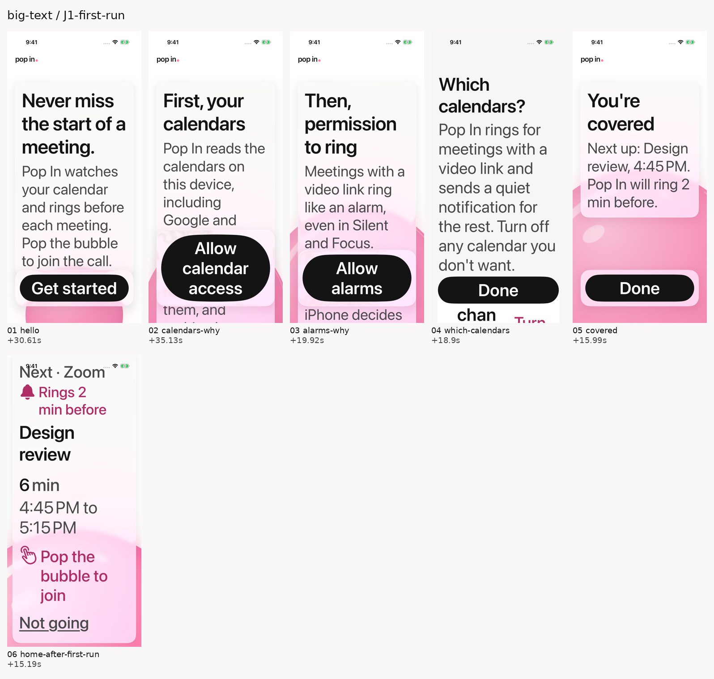
- on screen at hello: buttons ['Pop the bubble', 'Get started']; words ['pop in', 'Never miss the start of a meeting.', 'Pop In watches your calendar and rings b']
- on screen at which-calendars: buttons ['Exchange, 1 of 1 calendars on', 'Turn all off', 'Work alerts: Smart', 'iCloud, 2 of 2 calendars on', 'Turn all off', 'Family alerts: Smart', 'Home alerts: Smart', 'Done']; words ['Which calendars?', 'Pop In rings for meetings with a video l', 'Exchange', '1 of 1 on', 'Work', 'Smart', 'iCloud', '2 of 2 on', 'Family', 'Smart', 'Home', 'Smart', 'Smart rings full screen for meetings wit']

### big-text / J10-fortune (23 s, 3 checks held, 0 did not)
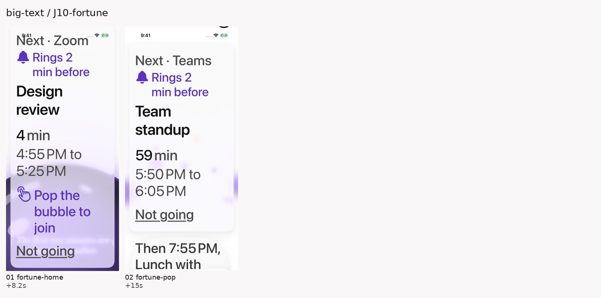
- on screen at fortune-home: buttons ['Pop the bubble to join Design review. Fortune: The first two minutes are about the weather.', 'More: add a reminder, pop for fun, pause alerts, settings', 'Not going']; words ['The first two minutes are about the weat', 'pop in', 'Next · Zoom, Rings 2 min before, Design ', 'Next · Zoom', 'Rings 2 min before', 'Design review', '4', 'min', '4:55\u202fPM to 5:25\u202fPM', 'Pop the bubble to join', 'Then 5:50\u202fPM, Team standup']

### big-text / J11-moon-grenade (88 s, 5 checks held, 0 did not)
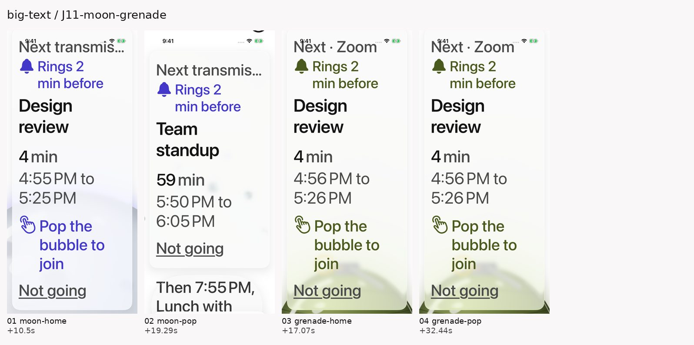

### big-text / J12-all-themes (650 s, 80 checks held, 0 did not)

### big-text / J13-edge-cases (57 s, 0 checks held, 0 did not)
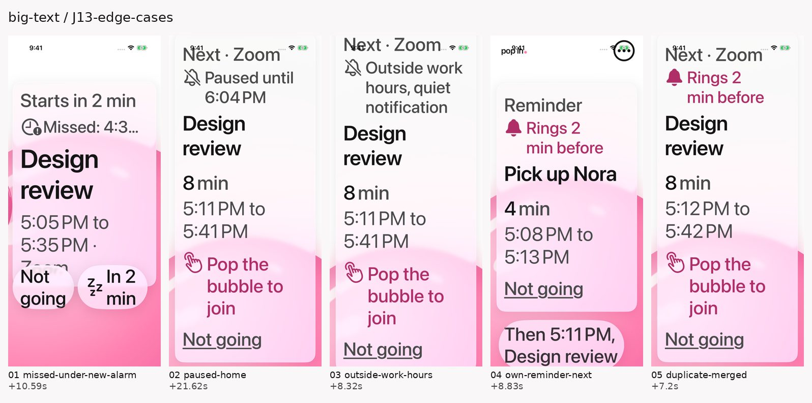

### big-text / J2-home-soon (50 s, 11 checks held, 0 did not)
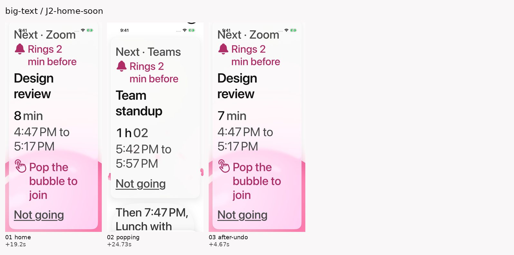
- on screen at home: buttons ['Pop the bubble to join Design review', 'More: add a reminder, pop for fun, pause alerts, settings', 'Not going']; words ['pop in', 'Next · Zoom, Rings 2 min before, Design ', 'Next · Zoom', 'Rings 2 min before', 'Design review', '8', 'min', '4:47\u202fPM to 5:17\u202fPM', 'Pop the bubble to join', 'Then 5:42\u202fPM, Team standup']

### big-text / J3-not-going (20 s, 5 checks held, 0 did not)
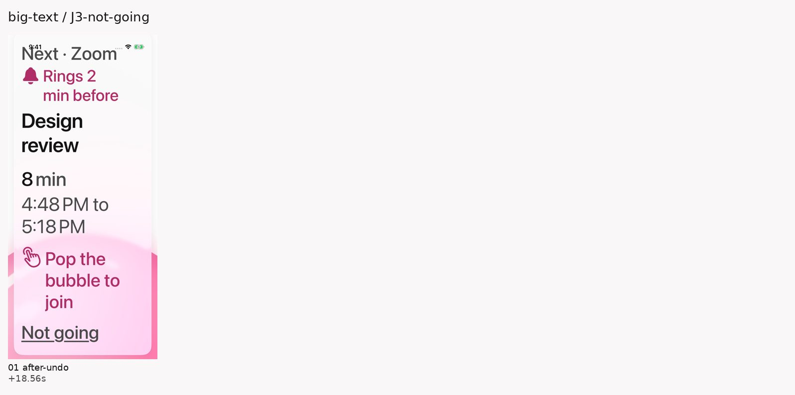

### big-text / J4-home-far (14 s, 2 checks held, 0 did not)
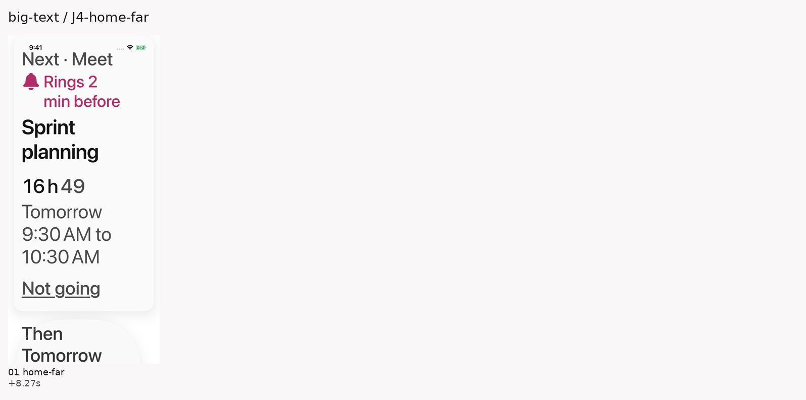
- on screen at home-far: buttons ['Pop the bubble to join Sprint planning', 'More: add a reminder, pop for fun, pause alerts, settings', 'Not going']; words ['pop in', 'Next · Meet, Rings 2 min before, Sprint ', 'Next · Meet', 'Rings 2 min before', 'Sprint planning', '16 h', '49', 'Tomorrow 9:30\u202fAM to 10:30\u202fAM', 'Then Tomorrow 4:35\u202fPM, Design review']

### big-text / J5-takeover (89 s, 5 checks held, 0 did not)
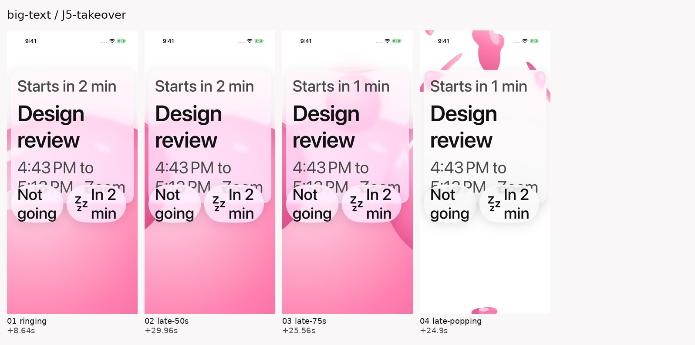
- on screen at ringing: buttons ['Pop the bubble to join Design review', 'Not going', 'Snooze two minutes']; words ['Starts in 2 min', 'Design review', '4:43\u202fPM to 5:13\u202fPM · Zoom', 'In 2 min']

### big-text / J6-settings (322 s, 18 checks held, 0 did not)
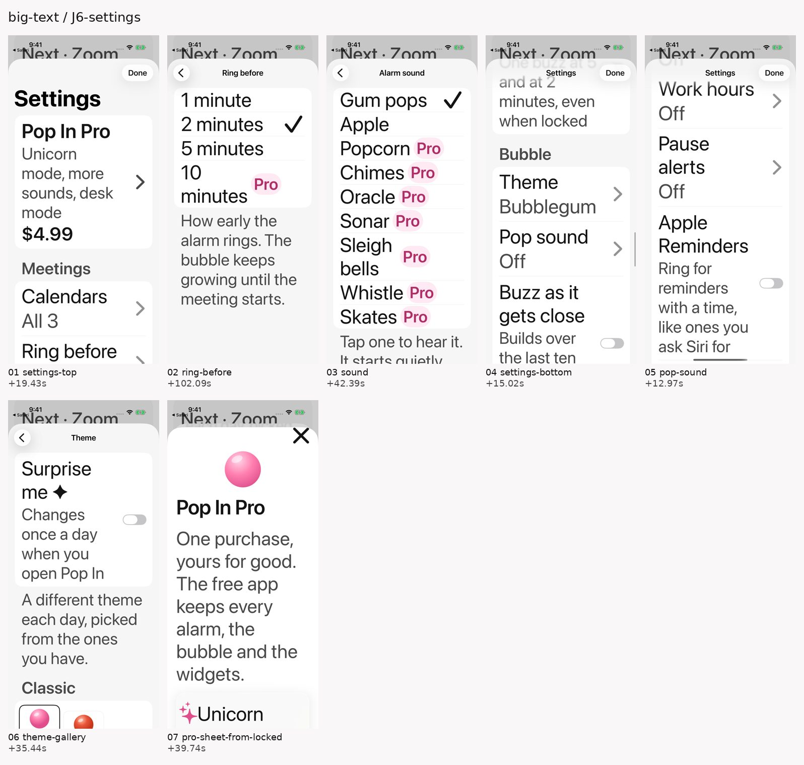
- on screen at settings: buttons ['Done', 'Pop In Pro, Unicorn mode, more sounds, desk mode, $4.99', 'Calendars, All 3', 'Ring before, 2 min', 'Early alarm, Off', 'Work hours, Off', 'Pause alerts, Off', 'Test the alarm, Rings in 20 seconds, the same way a meeting would', 'Sound, Gum pops', 'Theme, Bubblegum', 'Pop sound, Off', 'Tip $0.99', 'Tip $2.99', 'Tip $4.99']; words ['Settings', 'Pop In Pro', 'Unicorn mode, more sounds, desk mode', '$4.99', 'Meetings', 'Calendars', 'All 3', 'Ring before', '2 min', 'Early alarm', 'Off', 'Work hours', 'Off', 'Pause alerts']
- on screen at settings-bottom: buttons ['Done', 'Pop In Pro, Unicorn mode, more sounds, desk mode, $4.99', 'Calendars, All 3', 'Ring before, 2 min', 'Early alarm, Off', 'Work hours, Off', 'Pause alerts, Off', 'Test the alarm, Rings in 20 seconds, the same way a meeting would', 'Sound, Gum pops', 'Theme, Bubblegum', 'Pop sound, Off', 'Tip $0.99', 'Tip $2.99', 'Tip $4.99']; words ['Settings', 'Pop In Pro', 'Unicorn mode, more sounds, desk mode', '$4.99', 'Meetings', 'Calendars', 'All 3', 'Ring before', '2 min', 'Early alarm', 'Off', 'Work hours', 'Off', 'Pause alerts']

### big-text / J7-many-calendars (79 s, 8 checks held, 0 did not)
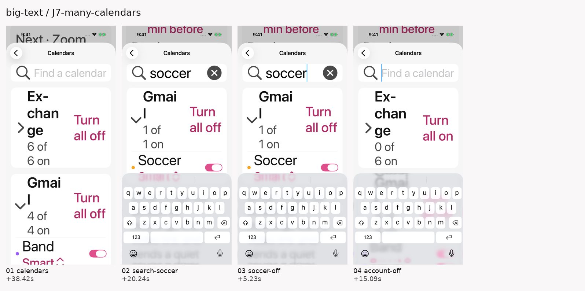
- on screen at calendars: buttons ['Settings', 'Exchange, 6 of 6 calendars on', 'Turn all off', 'Gmail, 4 of 4 calendars on', 'Turn all off', 'Band alerts: Smart', 'Personal alerts: Smart', 'School alerts: Smart', 'Soccer alerts: Smart', 'iCloud, 5 of 5 calendars on', 'Turn all off', 'Anniversaries alerts: Smart', 'Birthdays alerts: Smart', 'Family alerts: Smart']; words ['Calendars', 'Exchange', '6 of 6 on', 'Gmail', '4 of 4 on', 'Band', 'Smart', 'Personal', 'Smart', 'School', 'Smart', 'Soccer', 'Smart', 'iCloud']

### big-text / J8-empty (20 s, 2 checks held, 0 did not)
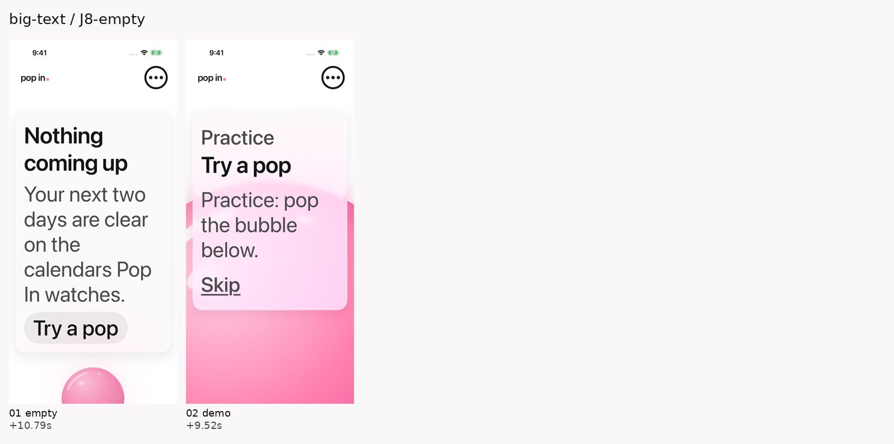
- on screen at empty: buttons ['More: add a reminder, pop for fun, pause alerts, settings', 'Try a pop']; words ['pop in', 'Nothing coming up', 'Your next two days are clear on the cale']
- on screen at demo: buttons ['Pop the bubble to clear Try a pop', 'More: add a reminder, pop for fun, pause alerts, settings', 'Skip']; words ['pop in', 'Practice, Try a pop, Practice: pop the b', 'Practice', 'Try a pop', 'Practice: pop the bubble below.']

### big-text / J9-unicorn (27 s, 2 checks held, 0 did not)
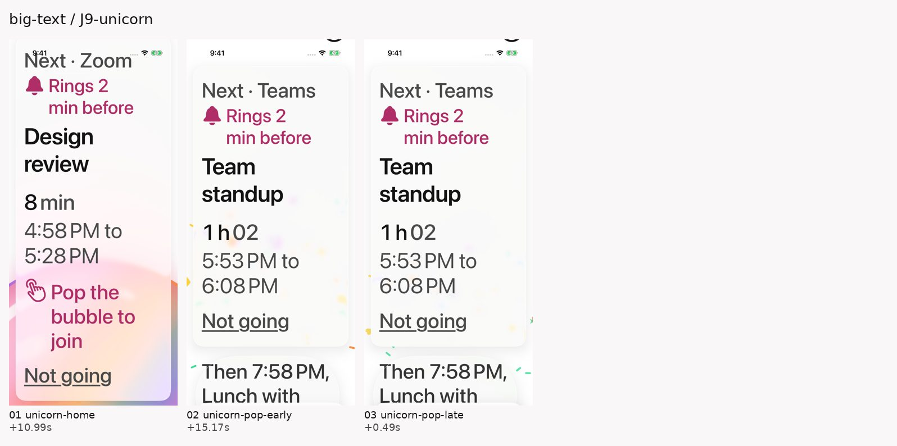

### ipad / J1-first-run (104 s, 10 checks held, 0 did not)
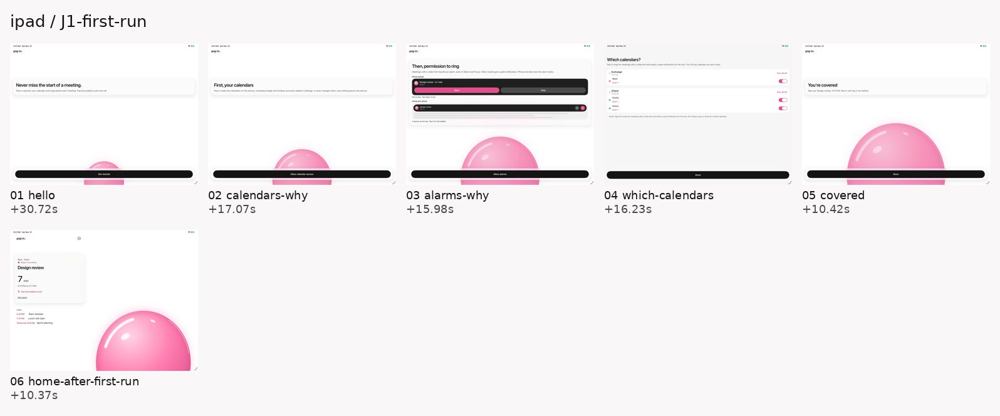
- on screen at hello: buttons ['Pop the bubble', 'Get started']; words ['pop in', 'Never miss the start of a meeting.', 'Pop In watches your calendar and rings b']
- on screen at which-calendars: buttons ['Exchange, 1 of 1 calendars on', 'Turn all off', 'Work alerts: Smart', 'iCloud, 2 of 2 calendars on', 'Turn all off', 'Family alerts: Smart', 'Home alerts: Smart', 'Done']; words ['Which calendars?', 'Pop In rings for meetings with a video l', 'Exchange', '1 of 1 on', 'Work', 'Smart', 'iCloud', '2 of 2 on', 'Family', 'Smart', 'Home', 'Smart', 'Smart rings full screen for meetings wit']

### ipad / J10-fortune (24 s, 3 checks held, 0 did not)
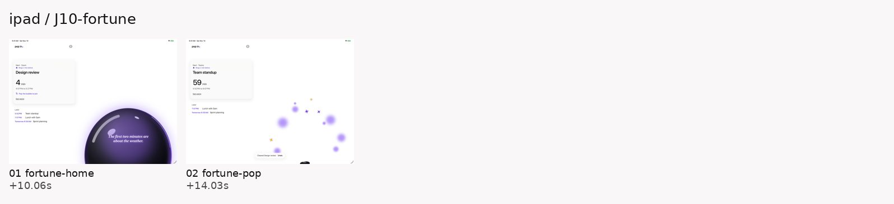
- on screen at fortune-home: buttons ['More: add a reminder, pop for fun, pause alerts, settings', 'Not going', 'Pop the bubble to join Design review. Fortune: The first two minutes are about the weather.']; words ['pop in', 'Next · Zoom, Rings 2 min before, Design ', 'Next · Zoom', 'Rings 2 min before', 'Design review', '4', 'min', '4:57\u202fPM to 5:27\u202fPM', 'Pop the bubble to join', 'Later', '5:52\u202fPM', 'Team standup', '7:57\u202fPM', 'Lunch with Sam']

### ipad / J11-moon-grenade (56 s, 5 checks held, 0 did not)
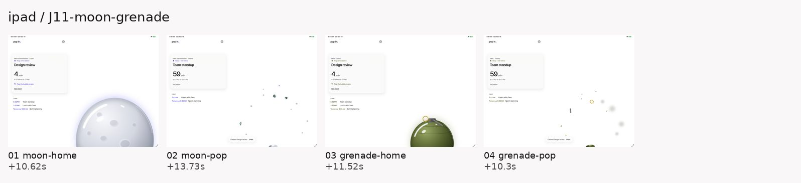

### ipad / J12-all-themes (686 s, 80 checks held, 0 did not)
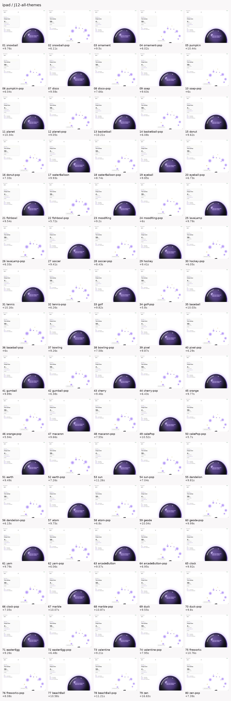

### ipad / J13-edge-cases (127 s, 0 checks held, 0 did not)
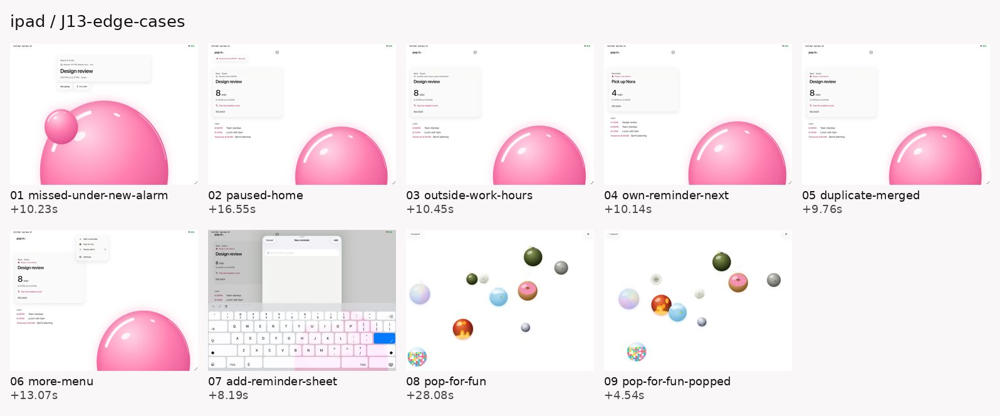

### ipad / J2-home-soon (42 s, 11 checks held, 0 did not)
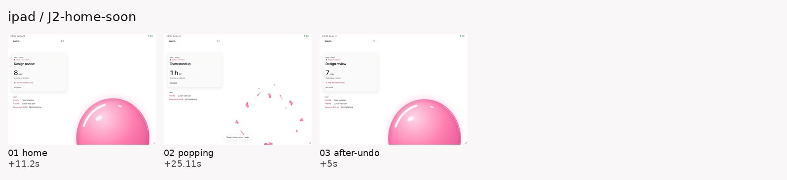
- on screen at home: buttons ['More: add a reminder, pop for fun, pause alerts, settings', 'Not going', 'Pop the bubble to join Design review']; words ['pop in', 'Next · Zoom, Rings 2 min before, Design ', 'Next · Zoom', 'Rings 2 min before', 'Design review', '8', 'min', '4:48\u202fPM to 5:18\u202fPM', 'Pop the bubble to join', 'Later', '5:43\u202fPM', 'Team standup', '7:48\u202fPM', 'Lunch with Sam']

### ipad / J3-not-going (18 s, 5 checks held, 0 did not)
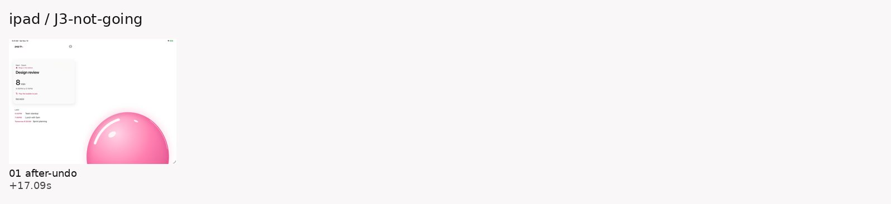

### ipad / J4-home-far (21 s, 2 checks held, 0 did not)
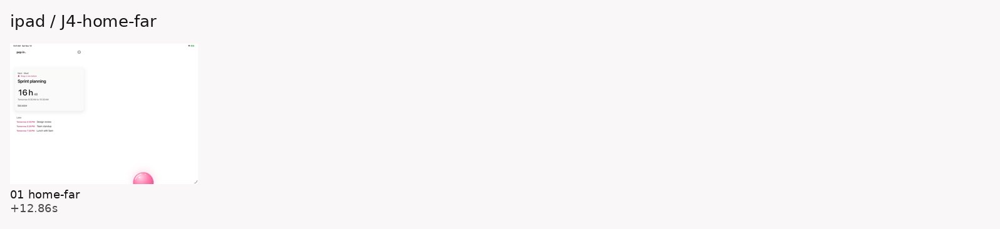
- on screen at home-far: buttons ['More: add a reminder, pop for fun, pause alerts, settings', 'Not going', 'Pop the bubble to join Sprint planning']; words ['pop in', 'Next · Meet, Rings 2 min before, Sprint ', 'Next · Meet', 'Rings 2 min before', 'Sprint planning', '16 h', '48', 'Tomorrow 9:30\u202fAM to 10:30\u202fAM', 'Later', 'Tomorrow 4:35\u202fPM', 'Design review', 'Tomorrow 5:30\u202fPM', 'Team standup', 'Tomorrow 7:35\u202fPM']

### ipad / J5-takeover (161 s, 5 checks held, 0 did not)
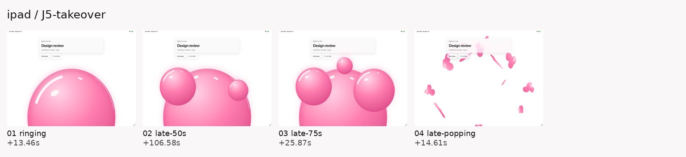
- on screen at ringing: buttons ['Pop the bubble to join Design review', 'Not going', 'Snooze two minutes']; words ['Starts in 2 min', 'Design review', '4:44\u202fPM to 5:14\u202fPM · Zoom', 'In 2 min']

### ipad / J6-settings (319 s, 18 checks held, 0 did not)
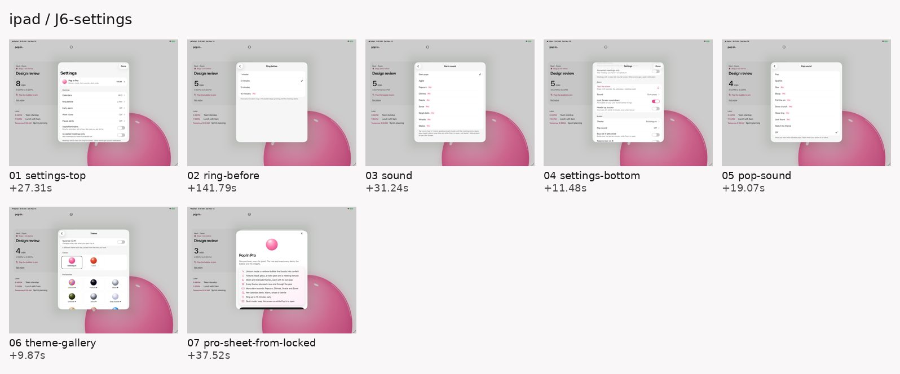
- on screen at settings: buttons ['Done', 'Pop In Pro, Unicorn mode, more sounds, desk mode, $4.99', 'Calendars, All 3', 'Ring before, 2 min', 'Early alarm, Off', 'Work hours, Off', 'Pause alerts, Off', 'Test the alarm, Rings in 20 seconds, the same way a meeting would', 'Sound, Gum pops', 'Theme, Bubblegum', 'Pop sound, Off', 'Tip $0.99', 'Tip $2.99', 'Tip $4.99']; words ['Settings', 'Pop In Pro', 'Unicorn mode, more sounds, desk mode', '$4.99', 'Meetings', 'Calendars', 'All 3', 'Ring before', '2 min', 'Early alarm', 'Off', 'Work hours', 'Off', 'Pause alerts']
- on screen at settings-bottom: buttons ['Done', 'Pop In Pro, Unicorn mode, more sounds, desk mode, $4.99', 'Calendars, All 3', 'Ring before, 2 min', 'Early alarm, Off', 'Work hours, Off', 'Pause alerts, Off', 'Test the alarm, Rings in 20 seconds, the same way a meeting would', 'Sound, Gum pops', 'Theme, Bubblegum', 'Pop sound, Off', 'Tip $0.99', 'Tip $2.99', 'Tip $4.99']; words ['Settings', 'Pop In Pro', 'Unicorn mode, more sounds, desk mode', '$4.99', 'Meetings', 'Calendars', 'All 3', 'Ring before', '2 min', 'Early alarm', 'Off', 'Work hours', 'Off', 'Pause alerts']

### ipad / J7-many-calendars (71 s, 8 checks held, 0 did not)
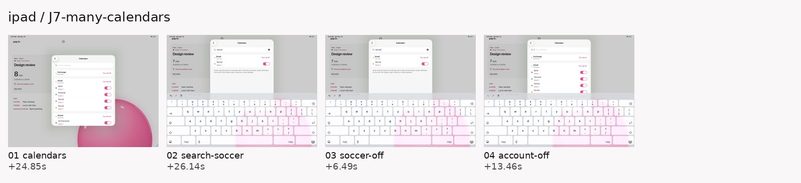
- on screen at calendars: buttons ['Settings', 'Exchange, 6 of 6 calendars on', 'Turn all off', 'Gmail, 4 of 4 calendars on', 'Turn all off', 'Band alerts: Smart', 'Personal alerts: Smart', 'School alerts: Smart', 'Soccer alerts: Smart', 'iCloud, 5 of 5 calendars on', 'Turn all off', 'Anniversaries alerts: Smart', 'Birthdays alerts: Smart', 'Family alerts: Smart']; words ['Calendars', 'Exchange', '6 of 6 on', 'Gmail', '4 of 4 on', 'Band', 'Smart', 'Personal', 'Smart', 'School', 'Smart', 'Soccer', 'Smart', 'iCloud']

### ipad / J8-empty (23 s, 2 checks held, 0 did not)
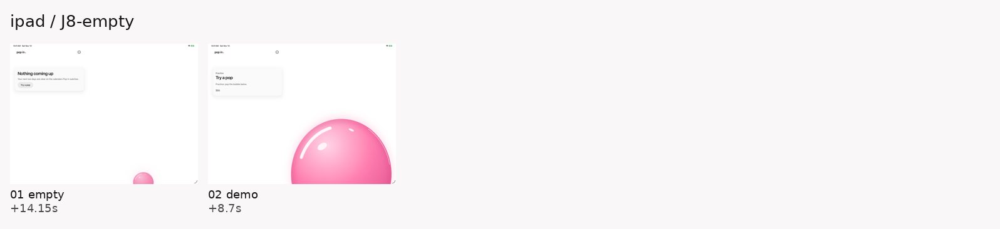
- on screen at empty: buttons ['More: add a reminder, pop for fun, pause alerts, settings', 'Try a pop']; words ['pop in', 'Nothing coming up', 'Your next two days are clear on the cale']
- on screen at demo: buttons ['More: add a reminder, pop for fun, pause alerts, settings', 'Skip', 'Pop the bubble to clear Try a pop']; words ['pop in', 'Practice, Try a pop, Practice: pop the b', 'Practice', 'Try a pop', 'Practice: pop the bubble below.']

### ipad / J9-unicorn (23 s, 2 checks held, 0 did not)
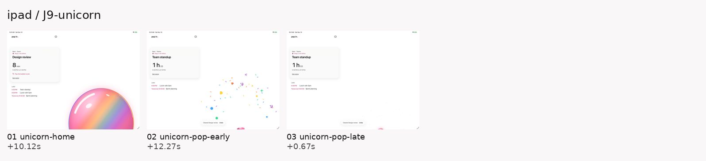

### pro-light / J1-first-run (73 s, 10 checks held, 0 did not)
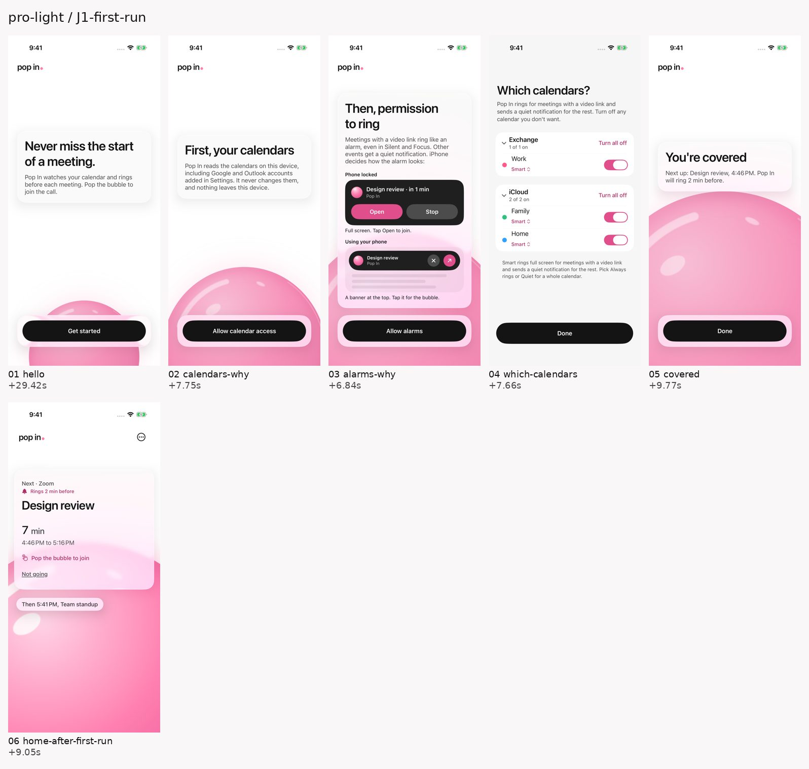
- on screen at hello: buttons ['Pop the bubble', 'Get started']; words ['pop in', 'Never miss the start of a meeting.', 'Pop In watches your calendar and rings b']
- on screen at which-calendars: buttons ['Exchange, 1 of 1 calendars on', 'Turn all off', 'Work alerts: Smart', 'iCloud, 2 of 2 calendars on', 'Turn all off', 'Family alerts: Smart', 'Home alerts: Smart', 'Done']; words ['Which calendars?', 'Pop In rings for meetings with a video l', 'Exchange', '1 of 1 on', 'Work', 'Smart', 'iCloud', '2 of 2 on', 'Family', 'Smart', 'Home', 'Smart', 'Smart rings full screen for meetings wit']

### pro-light / J10-fortune (26 s, 3 checks held, 0 did not)
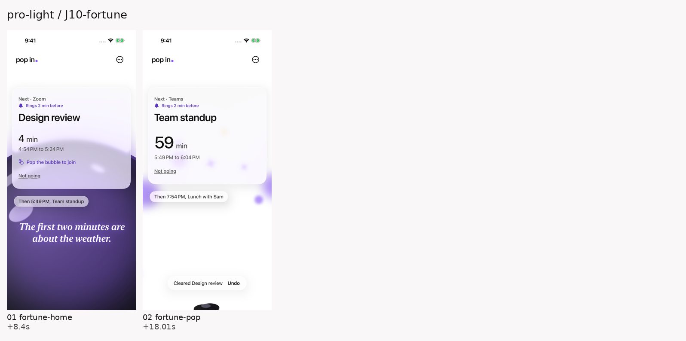
- on screen at fortune-home: buttons ['Pop the bubble to join Design review. Fortune: The first two minutes are about the weather.', 'More: add a reminder, pop for fun, pause alerts, settings', 'Not going']; words ['The first two minutes are about the weat', 'pop in', 'Next · Zoom, Rings 2 min before, Design ', 'Next · Zoom', 'Rings 2 min before', 'Design review', '4', 'min', '4:54\u202fPM to 5:24\u202fPM', 'Pop the bubble to join', 'Then 5:49\u202fPM, Team standup']

### pro-light / J11-moon-grenade (57 s, 5 checks held, 0 did not)
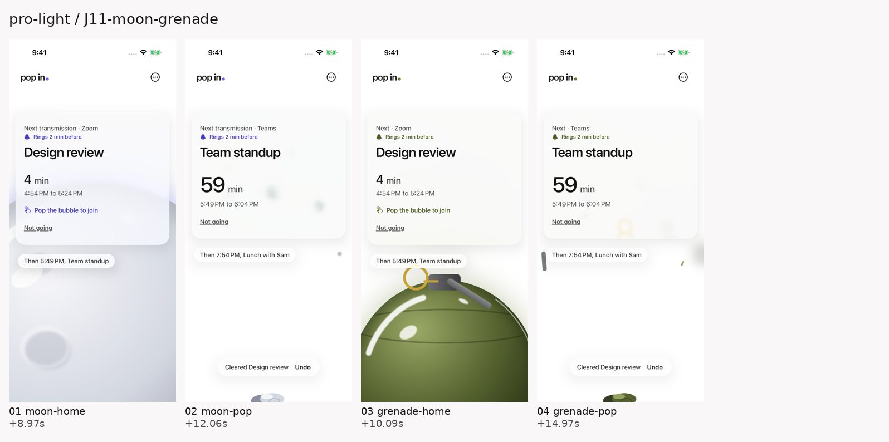

### pro-light / J12-all-themes (695 s, 80 checks held, 0 did not)

### pro-light / J13-edge-cases (128 s, 0 checks held, 0 did not)
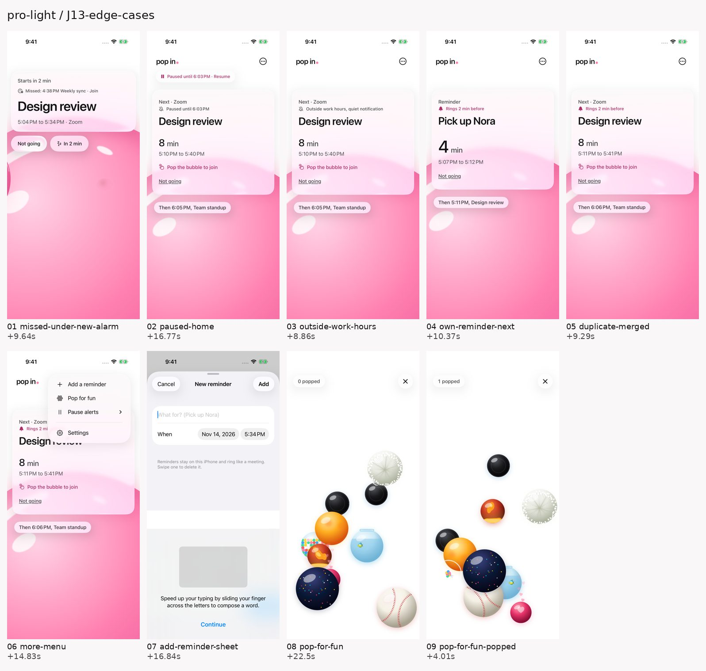

### pro-light / J2-home-soon (47 s, 11 checks held, 0 did not)
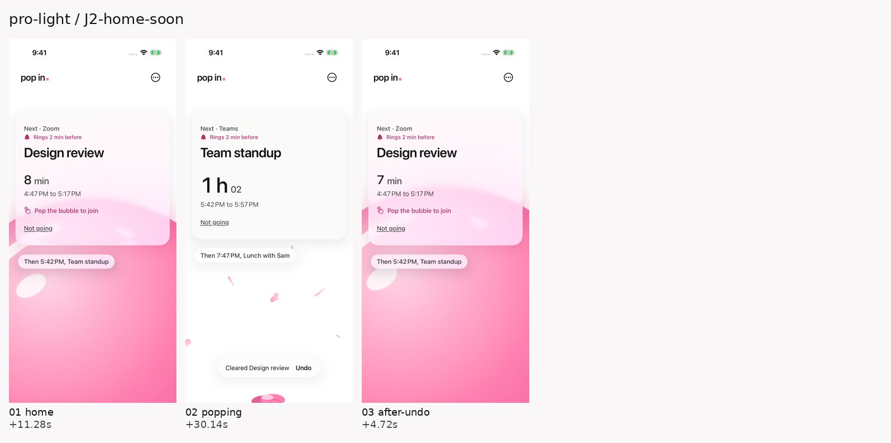
- on screen at home: buttons ['Pop the bubble to join Design review', 'More: add a reminder, pop for fun, pause alerts, settings', 'Not going']; words ['pop in', 'Next · Zoom, Rings 2 min before, Design ', 'Next · Zoom', 'Rings 2 min before', 'Design review', '8', 'min', '4:47\u202fPM to 5:17\u202fPM', 'Pop the bubble to join', 'Then 5:42\u202fPM, Team standup']

### pro-light / J3-not-going (22 s, 5 checks held, 0 did not)
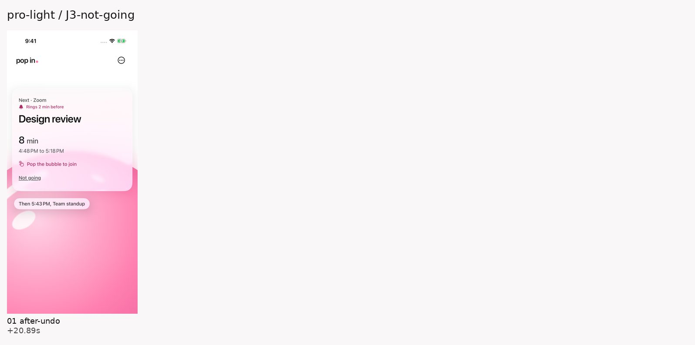

### pro-light / J4-home-far (32 s, 2 checks held, 0 did not)
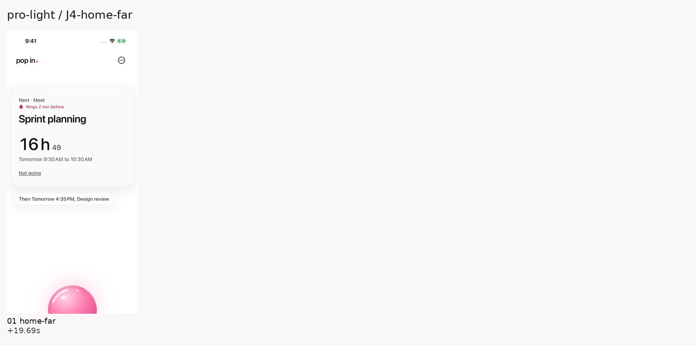
- on screen at home-far: buttons ['Pop the bubble to join Sprint planning', 'More: add a reminder, pop for fun, pause alerts, settings', 'Not going']; words ['pop in', 'Next · Meet, Rings 2 min before, Sprint ', 'Next · Meet', 'Rings 2 min before', 'Sprint planning', '16 h', '49', 'Tomorrow 9:30\u202fAM to 10:30\u202fAM', 'Then Tomorrow 4:35\u202fPM, Design review']

### pro-light / J5-takeover (73 s, 5 checks held, 0 did not)
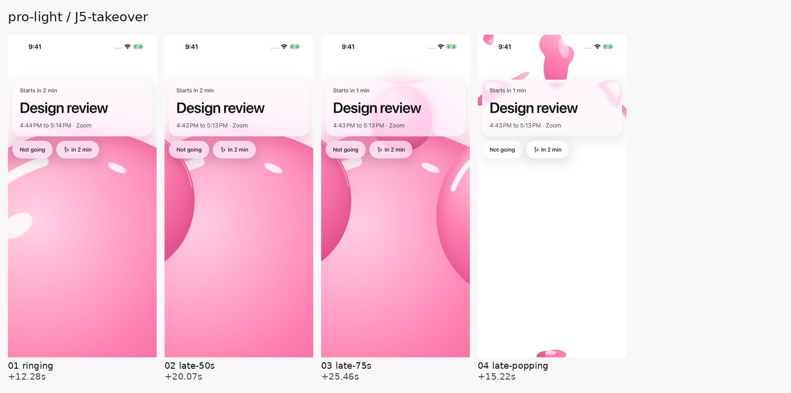
- on screen at ringing: buttons ['Pop the bubble to join Design review', 'Not going', 'Snooze two minutes']; words ['Starts in 2 min', 'Design review', '4:44\u202fPM to 5:14\u202fPM · Zoom', 'In 2 min']

### pro-light / J6-settings (299 s, 18 checks held, 0 did not)
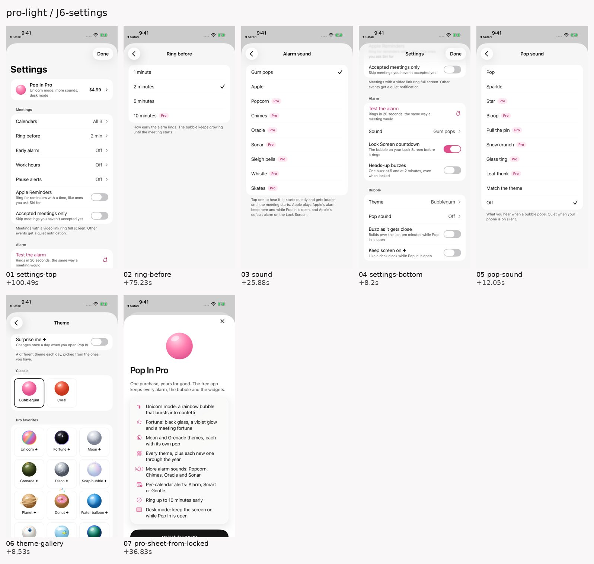
- on screen at settings: buttons ['Done', 'Pop In Pro, Unicorn mode, more sounds, desk mode, $4.99', 'Calendars, All 3', 'Ring before, 2 min', 'Early alarm, Off', 'Work hours, Off', 'Pause alerts, Off', 'Test the alarm, Rings in 20 seconds, the same way a meeting would', 'Sound, Gum pops', 'Theme, Bubblegum', 'Pop sound, Off', 'Tip $0.99', 'Tip $2.99', 'Tip $4.99']; words ['Settings', 'Pop In Pro', 'Unicorn mode, more sounds, desk mode', '$4.99', 'Meetings', 'Calendars', 'All 3', 'Ring before', '2 min', 'Early alarm', 'Off', 'Work hours', 'Off', 'Pause alerts']
- on screen at settings-bottom: buttons ['Done', 'Pop In Pro, Unicorn mode, more sounds, desk mode, $4.99', 'Calendars, All 3', 'Ring before, 2 min', 'Early alarm, Off', 'Work hours, Off', 'Pause alerts, Off', 'Test the alarm, Rings in 20 seconds, the same way a meeting would', 'Sound, Gum pops', 'Theme, Bubblegum', 'Pop sound, Off', 'Tip $0.99', 'Tip $2.99', 'Tip $4.99']; words ['Settings', 'Pop In Pro', 'Unicorn mode, more sounds, desk mode', '$4.99', 'Meetings', 'Calendars', 'All 3', 'Ring before', '2 min', 'Early alarm', 'Off', 'Work hours', 'Off', 'Pause alerts']

### pro-light / J7-many-calendars (65 s, 8 checks held, 0 did not)
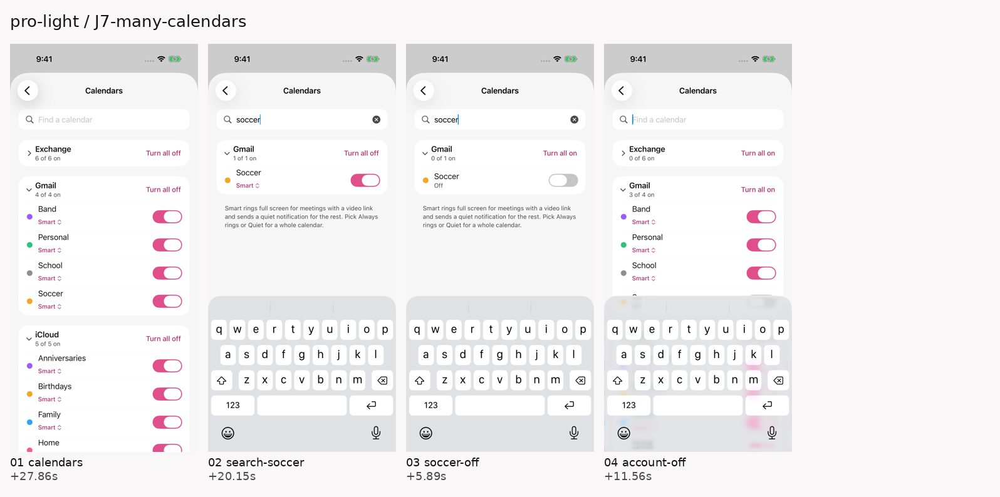
- on screen at calendars: buttons ['Settings', 'Exchange, 6 of 6 calendars on', 'Turn all off', 'Gmail, 4 of 4 calendars on', 'Turn all off', 'Band alerts: Smart', 'Personal alerts: Smart', 'School alerts: Smart', 'Soccer alerts: Smart', 'iCloud, 5 of 5 calendars on', 'Turn all off', 'Anniversaries alerts: Smart', 'Birthdays alerts: Smart', 'Family alerts: Smart']; words ['Calendars', 'Exchange', '6 of 6 on', 'Gmail', '4 of 4 on', 'Band', 'Smart', 'Personal', 'Smart', 'School', 'Smart', 'Soccer', 'Smart', 'iCloud']

### pro-light / J8-empty (23 s, 2 checks held, 0 did not)
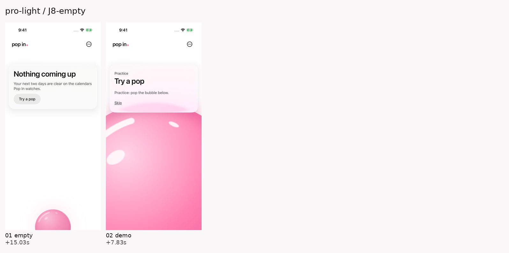
- on screen at empty: buttons ['More: add a reminder, pop for fun, pause alerts, settings', 'Try a pop']; words ['pop in', 'Nothing coming up', 'Your next two days are clear on the cale']
- on screen at demo: buttons ['Pop the bubble to clear Try a pop', 'More: add a reminder, pop for fun, pause alerts, settings', 'Skip']; words ['pop in', 'Practice, Try a pop, Practice: pop the b', 'Practice', 'Try a pop', 'Practice: pop the bubble below.']

### pro-light / J9-unicorn (17 s, 2 checks held, 0 did not)
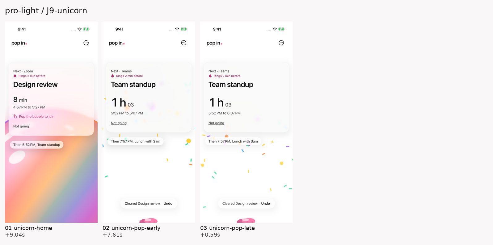

### small-phone / J1-first-run (64 s, 10 checks held, 0 did not)
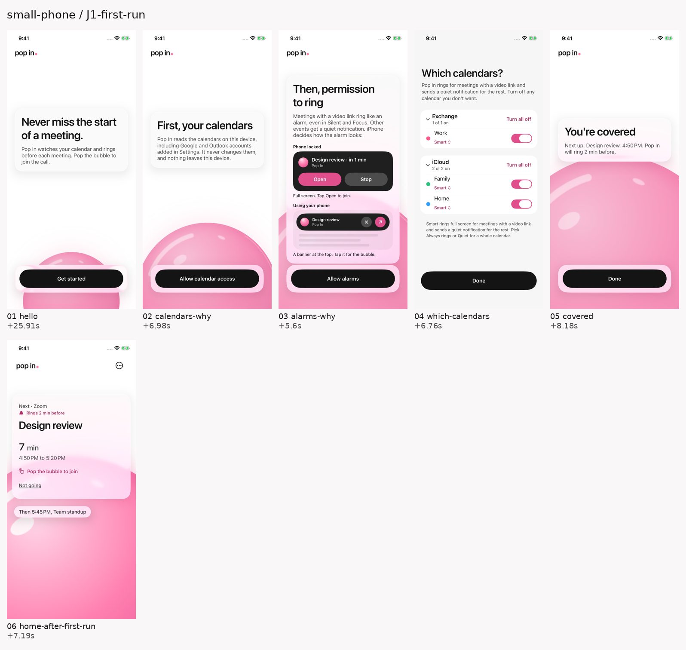
- on screen at hello: buttons ['Pop the bubble', 'Get started']; words ['pop in', 'Never miss the start of a meeting.', 'Pop In watches your calendar and rings b']
- on screen at which-calendars: buttons ['Exchange, 1 of 1 calendars on', 'Turn all off', 'Work alerts: Smart', 'iCloud, 2 of 2 calendars on', 'Turn all off', 'Family alerts: Smart', 'Home alerts: Smart', 'Done']; words ['Which calendars?', 'Pop In rings for meetings with a video l', 'Exchange', '1 of 1 on', 'Work', 'Smart', 'iCloud', '2 of 2 on', 'Family', 'Smart', 'Home', 'Smart', 'Smart rings full screen for meetings wit']

### small-phone / J10-fortune (29 s, 3 checks held, 0 did not)
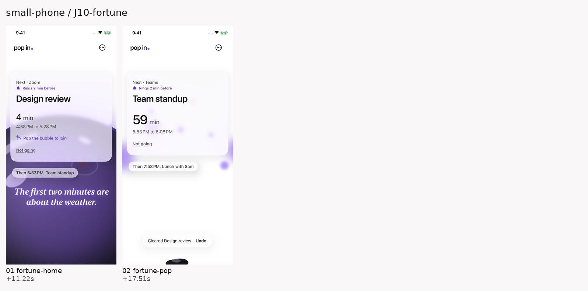
- on screen at fortune-home: buttons ['Pop the bubble to join Design review. Fortune: The first two minutes are about the weather.', 'More: add a reminder, pop for fun, pause alerts, settings', 'Not going']; words ['The first two minutes are about the weat', 'pop in', 'Next · Zoom, Rings 2 min before, Design ', 'Next · Zoom', 'Rings 2 min before', 'Design review', '4', 'min', '4:58\u202fPM to 5:28\u202fPM', 'Pop the bubble to join', 'Then 5:53\u202fPM, Team standup']

### small-phone / J11-moon-grenade (60 s, 5 checks held, 0 did not)
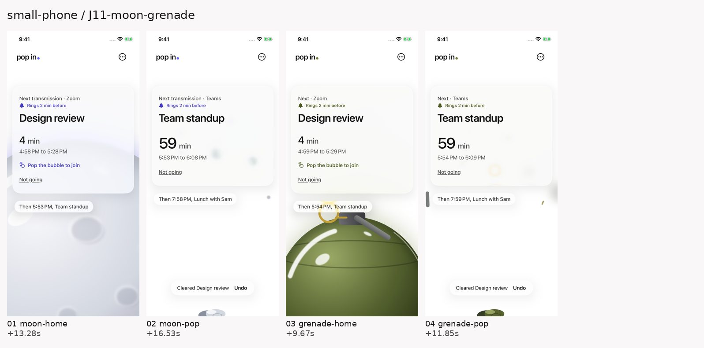

### small-phone / J12-all-themes (597 s, 80 checks held, 0 did not)

### small-phone / J13-edge-cases (97 s, 0 checks held, 0 did not)
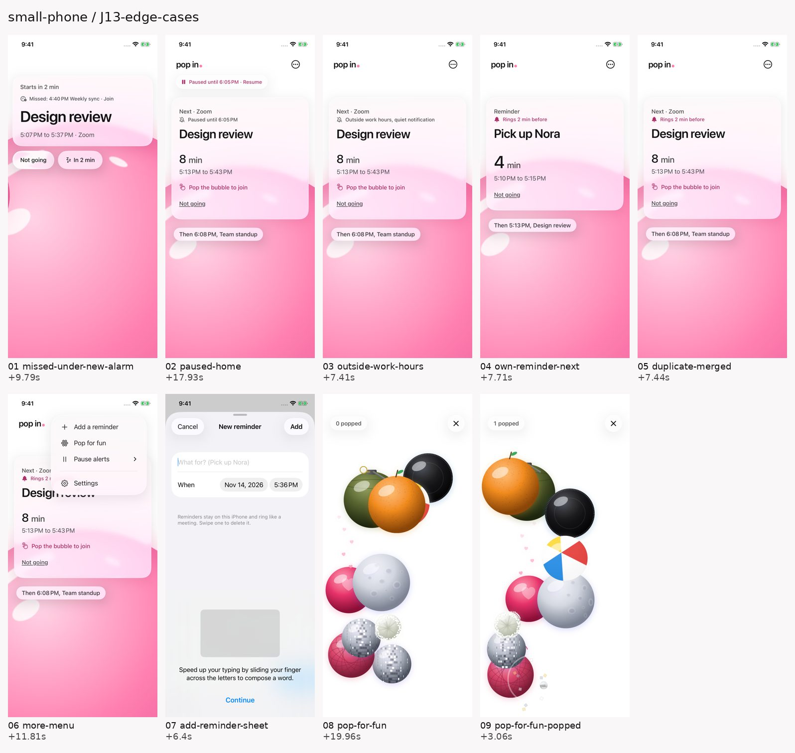

### small-phone / J2-home-soon (68 s, 11 checks held, 0 did not)
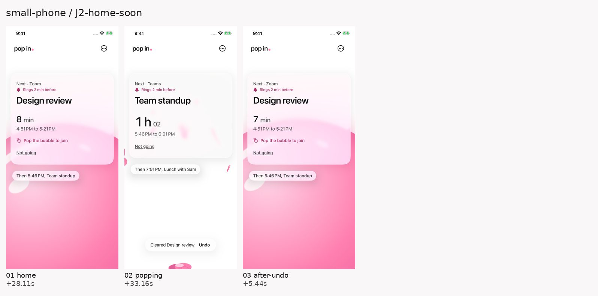
- on screen at home: buttons ['Pop the bubble to join Design review', 'More: add a reminder, pop for fun, pause alerts, settings', 'Not going']; words ['pop in', 'Next · Zoom, Rings 2 min before, Design ', 'Next · Zoom', 'Rings 2 min before', 'Design review', '8', 'min', '4:51\u202fPM to 5:21\u202fPM', 'Pop the bubble to join', 'Then 5:46\u202fPM, Team standup']

### small-phone / J3-not-going (19 s, 5 checks held, 0 did not)

### small-phone / J4-home-far (15 s, 2 checks held, 0 did not)
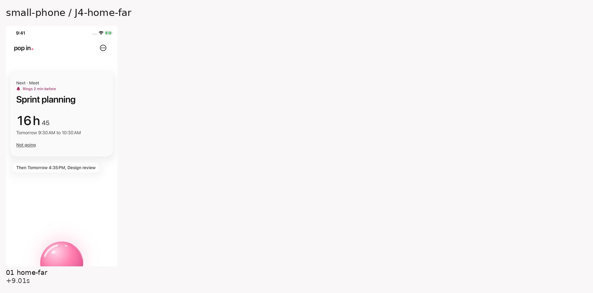
- on screen at home-far: buttons ['Pop the bubble to join Sprint planning', 'More: add a reminder, pop for fun, pause alerts, settings', 'Not going']; words ['pop in', 'Next · Meet, Rings 2 min before, Sprint ', 'Next · Meet', 'Rings 2 min before', 'Sprint planning', '16 h', '45', 'Tomorrow 9:30\u202fAM to 10:30\u202fAM', 'Then Tomorrow 4:35\u202fPM, Design review']

### small-phone / J5-takeover (77 s, 5 checks held, 0 did not)
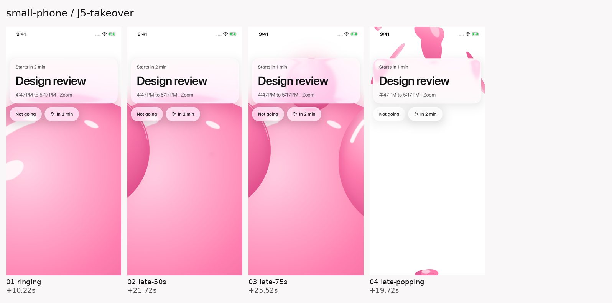
- on screen at ringing: buttons ['Pop the bubble to join Design review', 'Not going', 'Snooze two minutes']; words ['Starts in 2 min', 'Design review', '4:47\u202fPM to 5:17\u202fPM · Zoom', 'In 2 min']

### small-phone / J6-settings (292 s, 18 checks held, 0 did not)
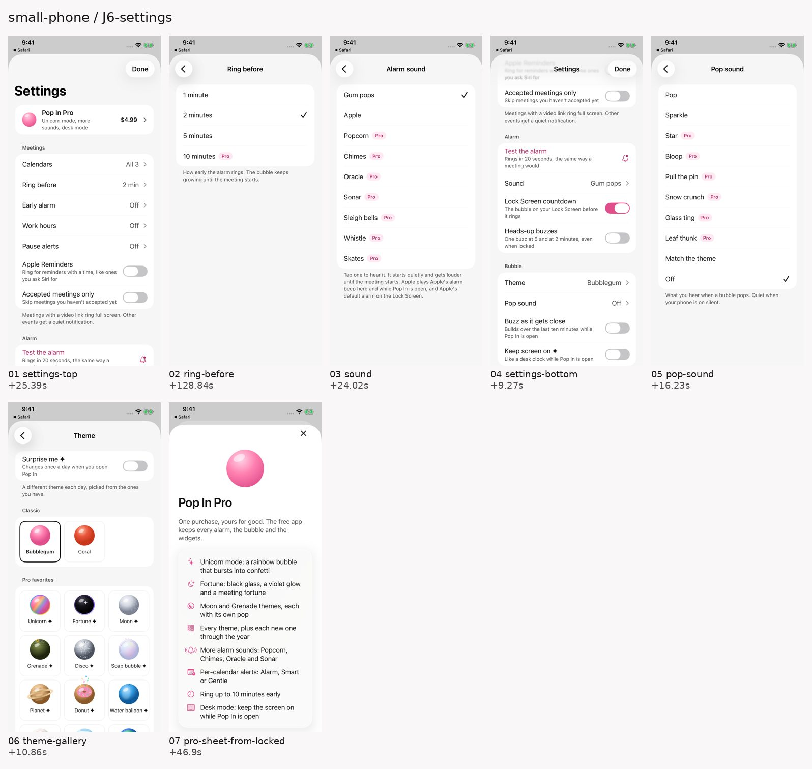
- on screen at settings: buttons ['Done', 'Pop In Pro, Unicorn mode, more sounds, desk mode, $4.99', 'Calendars, All 3', 'Ring before, 2 min', 'Early alarm, Off', 'Work hours, Off', 'Pause alerts, Off', 'Test the alarm, Rings in 20 seconds, the same way a meeting would', 'Sound, Gum pops', 'Theme, Bubblegum', 'Pop sound, Off', 'Tip $0.99', 'Tip $2.99', 'Tip $4.99']; words ['Settings', 'Pop In Pro', 'Unicorn mode, more sounds, desk mode', '$4.99', 'Meetings', 'Calendars', 'All 3', 'Ring before', '2 min', 'Early alarm', 'Off', 'Work hours', 'Off', 'Pause alerts']
- on screen at settings-bottom: buttons ['Done', 'Pop In Pro, Unicorn mode, more sounds, desk mode, $4.99', 'Calendars, All 3', 'Ring before, 2 min', 'Early alarm, Off', 'Work hours, Off', 'Pause alerts, Off', 'Test the alarm, Rings in 20 seconds, the same way a meeting would', 'Sound, Gum pops', 'Theme, Bubblegum', 'Pop sound, Off', 'Tip $0.99', 'Tip $2.99', 'Tip $4.99']; words ['Settings', 'Pop In Pro', 'Unicorn mode, more sounds, desk mode', '$4.99', 'Meetings', 'Calendars', 'All 3', 'Ring before', '2 min', 'Early alarm', 'Off', 'Work hours', 'Off', 'Pause alerts']

### small-phone / J7-many-calendars (67 s, 8 checks held, 0 did not)
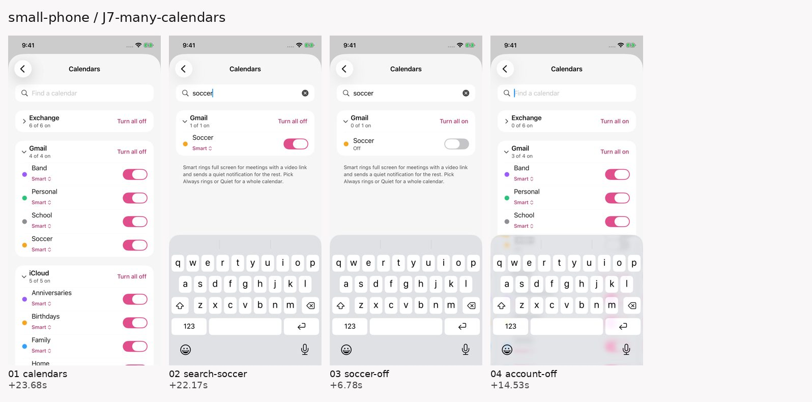
- on screen at calendars: buttons ['Settings', 'Exchange, 6 of 6 calendars on', 'Turn all off', 'Gmail, 4 of 4 calendars on', 'Turn all off', 'Band alerts: Smart', 'Personal alerts: Smart', 'School alerts: Smart', 'Soccer alerts: Smart', 'iCloud, 5 of 5 calendars on', 'Turn all off', 'Anniversaries alerts: Smart', 'Birthdays alerts: Smart', 'Family alerts: Smart']; words ['Calendars', 'Exchange', '6 of 6 on', 'Gmail', '4 of 4 on', 'Band', 'Smart', 'Personal', 'Smart', 'School', 'Smart', 'Soccer', 'Smart', 'iCloud']

### small-phone / J8-empty (26 s, 2 checks held, 0 did not)
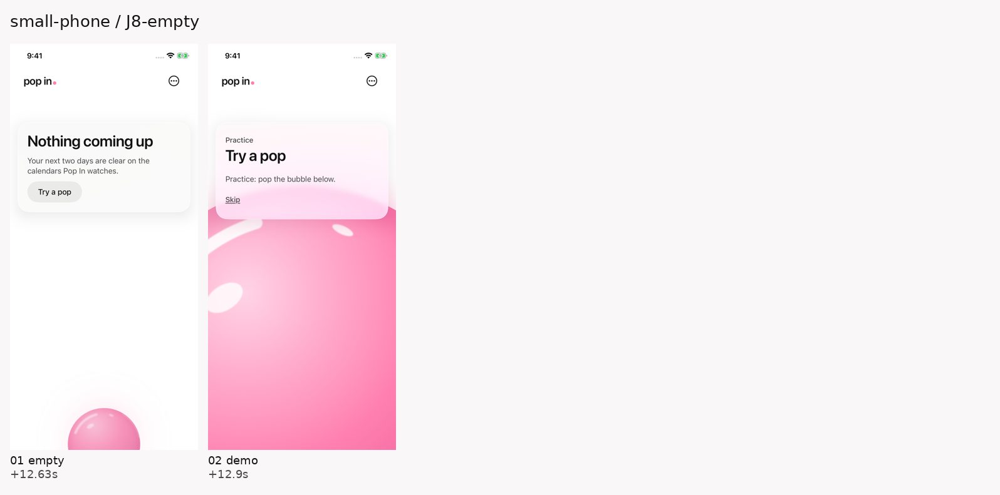
- on screen at empty: buttons ['More: add a reminder, pop for fun, pause alerts, settings', 'Try a pop']; words ['pop in', 'Nothing coming up', 'Your next two days are clear on the cale']
- on screen at demo: buttons ['Pop the bubble to clear Try a pop', 'More: add a reminder, pop for fun, pause alerts, settings', 'Skip']; words ['pop in', 'Practice, Try a pop, Practice: pop the b', 'Practice', 'Try a pop', 'Practice: pop the bubble below.']

### small-phone / J9-unicorn (21 s, 2 checks held, 0 did not)
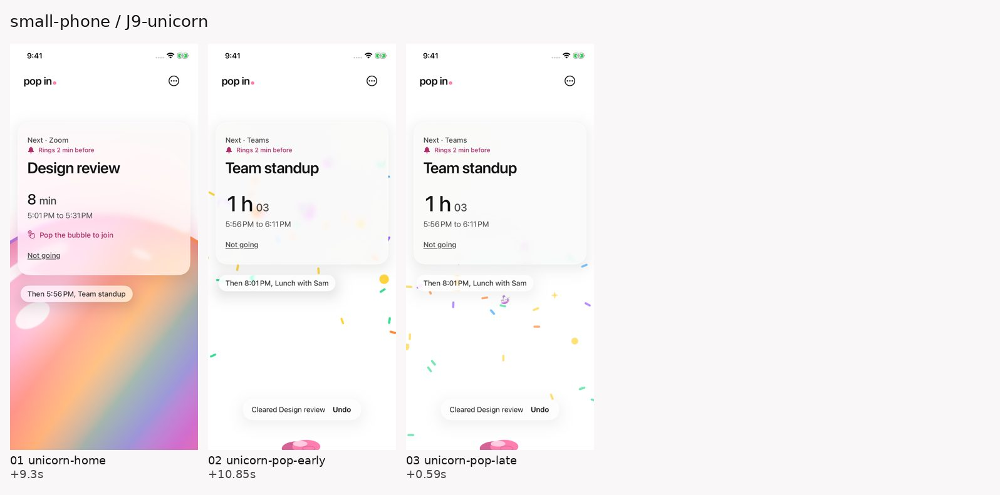

